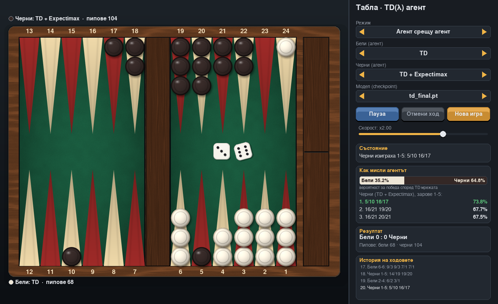
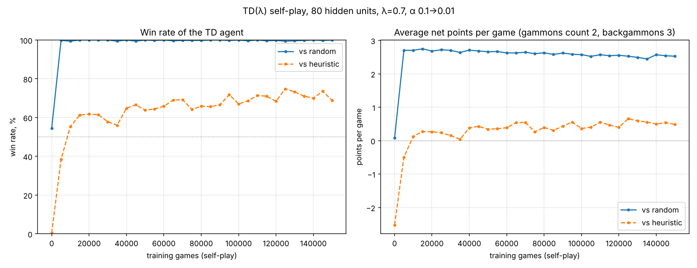

# Табла с интелигентен агент, който се учи сам (TD(λ))

Университетски проект по **интелигентни агенти**: програма, която сама се научава да играе
обикновена табла (стандартни правила на backgammon, **без удвояващ зар**), като играе
срещу себе си. Използван е методът на TD-Gammon (Gerald Tesauro), реализиран изцяло от нас:

* собствен двигател с правилата (без готови backgammon библиотеки, среди или модели);
* невронна мрежа 198 → 80 → 1 на PyTorch с **ръчно изведени градиенти**;
* обучение TD(λ) с **ръчно реализирани eligibility traces**;
* базови агенти за сравнение (случаен и евристичен), 2-ply Expectimax търсене;
* красива визуализация на pygame (всичко е рисувано програмно);
* документация за защитата: [`docs/algorithm.md`](docs/algorithm.md).





---

## 1. Инсталация на Windows

### 1.1. Python

1. Изтеглете **Python 3.11 или по-нов** (64-bit) от <https://www.python.org/downloads/windows/>.
2. При инсталацията отметнете **„Add python.exe to PATH“**.
3. Проверка в PowerShell:

```bash
py --version
```

### 1.2. Сваляне на проекта и виртуална среда

```bash
git clone https://github.com/MaxiTVBG/backgammon-agent.git
```

```bash
cd backgammon-agent
```

```bash
py -3.11 -m venv .venv
```

```bash
.venv\Scripts\activate
```

> Ако PowerShell откаже да изпълни `activate` („running scripts is disabled“), изпълнете веднъж
> `Set-ExecutionPolicy -Scope CurrentUser RemoteSigned` и опитайте отново.
> В `cmd.exe` командата е `.venv\Scripts\activate.bat`.

```bash
python -m pip install --upgrade pip
```

### 1.3. PyTorch с CUDA (за RTX 3080)

PyTorch с поддръжка на видеокартата се инсталира **преди** останалите пакети, от официалния
индекс на PyTorch. За RTX 3080 (архитектура Ampere) подхожда всяка CUDA 12.x версия;
нужен е само актуален NVIDIA драйвер (CUDA Toolkit **не** е нужен отделно):

```bash
pip install torch --index-url https://download.pytorch.org/whl/cu128
```

Ако тази версия вече не се предлага, изберете актуалната команда на
<https://pytorch.org/get-started/locally/> (Stable → Windows → Pip → Python → CUDA 12.x).
Проверка:

```bash
python -c "import torch; print(torch.__version__, torch.cuda.is_available(), torch.cuda.get_device_name(0))"
```

Трябва да види `True NVIDIA GeForce RTX 3080`.

> **Важно:** за това обучение видеокартата най-вероятно **няма** да е по-бърза от процесора
> (мрежата е малка, а TD обучението е строго последователно — виж раздел 4).
> Затова CPU версия на PyTorch също е напълно достатъчна:
> `pip install torch --index-url https://download.pytorch.org/whl/cpu`.

### 1.4. Останалите зависимости

```bash
pip install -r requirements.txt
```

### 1.5. Проверка на инсталацията

```bash
python -m pytest
```

Всички тестове трябва да минат (около 30 секунди).

---

## 2. Бърз старт

| Какво | Команда |
|---|---|
| Графичен интерфейс (човек срещу агент) | `python -m backgammon.gui` |
| Агент срещу агент в GUI | `python -m backgammon.gui --mode ava` |
| Игра в терминала | `python -m backgammon.play_cli --agent td` |
| Турнир между два агента | `python -m backgammon.tournament td heuristic --games 1000` |
| Кратко обучение (тест, ~1–3 мин.) | `python -m backgammon.training.train --games 2000` |
| Бенчмарк CPU срещу CUDA | `python -m backgammon.training.benchmark` |
| Графика от обучението | `python -m backgammon.training.plot runs/td_h80/eval.csv` |
| Сравнение TD срещу TD+Expectimax | `python -m backgammon.training.compare --games 1000` |

В репото има готов обучен модел `checkpoints/td_final.pt`, така че GUI и турнирите работят
веднага. Всички скриптове показват помощ с `--help`.

---

## 3. Обучение

### 3.1. Тестов режим (лаптоп)

```bash
python -m backgammon.training.train --games 2000
```

Минава за 1–3 минути. На всеки 1000 партии се прави оценка (500 партии срещу RandomAgent и
500 срещу HeuristicAgent). След 2000 партии агентът вече бие RandomAgent (обикновено ~85–95%).

### 3.2. Пълно обучение (настолен компютър: Ryzen 7 5800X, 64 GB RAM, RTX 3080)

```bash
python -m backgammon.training.train --config configs/full.json
```

Това е еквивалентно на:

```bash
python -m backgammon.training.train --games 300000 --hidden 80 --lr 0.1 --lr-min 0.01 --lambda 0.7 --eval-every 5000 --eval-games 1000 --run-name full_h80 --export checkpoints/td_final.pt
```

* `--device auto` (по подразбиране) прави кратък бенчмарк CPU/CUDA и избира по-бързото.
* Оценката срещу ботовете върви **паралелно** на всички ядра (`--workers`, по подразбиране
  брой ядра − 1 = 15 на 5800X). Самото TD обучение е последователно и използва 1 ядро.
* Прекъсване с **Ctrl+C** по всяко време — записва се checkpoint. Продължаване:

```bash
python -m backgammon.training.train --config configs/full.json --resume
```

* **Очаквано време** на 5800X: около 60–80 партии/сек. за обучението → 300 000 партии за
  ~1–1,5 часа + оценките (~3–5 сек. на всеки 5000 партии). 100 000 партии ≈ 25–35 минути.
* Понеже обучението ползва едно ядро, можете **паралелно** да пуснете втори експеримент
  с по-голяма мрежа в друг терминал:

```bash
python -m backgammon.training.train --config configs/full_h160.json --workers 6
```

### 3.3. Параметри на `train.py`

| Параметър | По подразбиране | Значение |
|---|---|---|
| `--games` | 2000 | общ брой партии (при `--resume` — до този брой) |
| `--hidden` | 80 | неврони в скрития слой |
| `--lr` / `--lr-min` | 0.1 / 0.01 | начална и крайна скорост на обучение α |
| `--lr-decay-games` | 200000 | за колко партии α намалява геометрично от `--lr` до `--lr-min` |
| `--lambda` | 0.7 | λ на eligibility traces |
| `--device` | auto | `auto`, `cpu` или `cuda` |
| `--threads` | 1 | нишки на PyTorch (1 е най-бързо за малката мрежа) |
| `--resume [път]` | – | продължаване (без път = последния checkpoint на същия run) |
| `--eval-every` | 1000 | оценка на всеки N партии (0 = без) |
| `--eval-games` | 500 | партии при всяка оценка, срещу всеки противник |
| `--save-every` | 1000 | checkpoint на всеки N партии |
| `--seed` | 1 | seed на генератора на случайни числа |
| `--workers` | ядра − 1 | процеси за паралелната оценка |
| `--run-name` | `td_h<hidden>` | име на експеримента |
| `--export` | – | копира финалния модел, напр. в `checkpoints/td_final.pt` |
| `--config` | – | JSON файл с горните параметри (CLI стойностите са с приоритет) |

### 3.4. Какво се записва

* `checkpoints/<run>/latest.pt` — за `--resume`;
* `checkpoints/<run>/td_<N>.pt` — снимка при всяка оценка; `best.pt` — най-добрият срещу Heuristic;
  `final.pt` — краят;
* `runs/<run>/eval.csv` — резултатите от оценките (за графиките);
* `runs/<run>/events.*` — TensorBoard (`tensorboard --logdir runs`, после <http://localhost:6006>).

Графика за презентацията:

```bash
python -m backgammon.training.plot runs/full_h80/eval.csv --out docs/img/training_curve.png
```

---

## 4. CPU или видеокарта?

Мрежата е миниатюрна (≈16 000 тегла), а TD(λ) обучението е **строго последователно**:
всеки ход зависи от теглата, обновени след предходния. За всеки ход се оценяват само ~20
позиции наведнъж. При такава работа видеокартата прекарва времето си в изчакване на
стартирането на CUDA ядра и в синхронизация CPU↔GPU, а Python кодът на правилата е еднакво
бавен и в двата случая. Затова процесорът обикновено е по-бърз. Това се **измерва**, не се гадае:

```bash
python -m backgammon.training.benchmark
```

Измерено в облачен контейнер (4 vCPU, без GPU):

| Тест | Резултат |
|---|---|
| Генериране на ходове | ~20 000 извиквания/сек (~19 крайни позиции на извикване) |
| Случайни партии | ~200 партии/сек |
| TD обучение, CPU, 1 нишка | ~50–80 партии/сек |
| TD обучение, CPU, 4 нишки | ~35 партии/сек (повече нишки само пречат) |

`--device auto` в `train.py` прави кратка версия на същия тест и избира по-бързото устройство.

---

## 5. Графичният интерфейс

```bash
python -m backgammon.gui
```

* **Начало:** всеки играч хвърля по един зар; по-високият получава белите и започва с двата зара.
* **Ход:** „Хвърли“ (или Space) → клик върху пул → маркират се валидните полета → клик върху
  поле (или върху тавата вдясно за изкарване). Невъзможните ходове изобщо не се предлагат —
  правилата (бар, задължителен по-голям зар, максимален брой зарове) се спазват автоматично.
* **Отмени ход** (или десен бутон / U) връща последната стъпка; **Готово** потвърждава хода.
* **Нова игра** (N) прилага избраните режим, противник и модел.
* **Агент срещу агент:** изберете режима и агентите за белите и черните; плъзгачът „Скорост“
  управлява темпото, бутонът „Пауза“ спира играта.
* **„Как мисли агентът“:** лента с вероятността за победа според TD мрежата и трите най-добре
  оценени хода на агента с оценките им.
* Брояч на пиповете, резултат и история на ходовете; прозорецът се оразмерява свободно.

Параметри: `--model път`, `--opponent random|heuristic|td|expectimax`, `--mode hva|ava`, `--size 1280x800`.

## 6. Игра в терминала

```bash
python -m backgammon.play_cli --agent td --color white
```

Въвежда се номерът на хода от списъка или записът му, напр. `24/18 13/11`
(`bar` = бар, `off` = изкарване). `l` — списък, `h` — помощ, `q` — изход.

---

## 7. Структура на проекта

```
backgammon/
  engine/        правила: състояние, генериране на ходове, край на играта, текстова дъска
    board.py       State, generate_moves (уникални afterstates), точкуване
    game.py        хвърляне на зарове, начално хвърляне, цикъл на партия
    render.py      ASCII дъска за терминала
  agents/        агенти
    base.py        общ интерфейс (choose / rank_moves / win_probability)
    random_agent.py, heuristic.py
    encoding.py    кодиране на Tesauro (198 входа)
    network.py     мрежата 198-H-1 и ръчните градиенти
    td_agent.py    1-ply агент (оценява всички ходове на един batch)
    expectimax.py  2-ply търсене по 21-те хвърляния на противника
    factory.py     създаване на агент от описание (за паралелните процеси)
  training/      обучение и оценка
    td_learner.py  TD(λ) с eligibility traces
    train.py       CLI за обучението
    evaluate.py    паралелни мачове (multiprocessing)
    benchmark.py   скорост на двигателя, CPU срещу CUDA
    compare.py     TD срещу TD+Expectimax
    plot.py        графики
  gui/           pygame визуализация (python -m backgammon.gui)
  play_cli.py    човек срещу агент в терминала
  tournament.py  турнир между два агента
tests/           pytest тестове (правила, агенти, мрежа, въвеждане на ходове)
configs/         примерни конфигурации за обучение
checkpoints/     модели (в git е само td_final.pt)
docs/            документация за защитата
```

## 8. Тестове

```bash
python -m pytest
```

Покриват: бар и влизане, блокирани полета, удряне, чифтове (4 хода), задължителни
„максимален брой зарове“ и „по-големия зар“, изкарване (вкл. с по-голям зар само от
най-далечното поле), невъзможен ход, марс и сух марс. Бързият генератор се сравнява и с
отделен, умишлено прост **референтен генератор** върху хиляди случайни позиции.
Тестват се също ръчните градиенти (срещу autograd), кодирането, агентите и въвеждането на
ходове в GUI (всеки легален ход трябва да може да се въведе стъпка по стъпка).

## 9. Резултати

Моделът в репото (`checkpoints/td_final.pt`) е обучен с 150 000 партии срещу себе си
(80 скрити неврона, λ = 0,7, α 0,1 → 0,01) за 44 минути на 4-ядрен облачен контейнер.
Дневникът на оценките е в `checkpoints/td_final_log.csv`.

| Агент | Противник | Партии | Победи | Точки/партия |
|---|---|---:|---:|---:|
| TD (1-ply) | Random | 1000 | 99,8% | +2,55 |
| TD (1-ply) | Heuristic | 2000 | 70,8% | +0,51 |
| TD + Expectimax (2-ply) | Heuristic | 400 | 76,0% | +0,66 |
| TD + Expectimax (2-ply) | TD (1-ply) | 400 | 55,2% | +0,11 |
| Heuristic | Random | 1000 | 99,7% | +2,64 |

Подробности, графики и изводи: [`docs/algorithm.md`](docs/algorithm.md#9-резултати).
